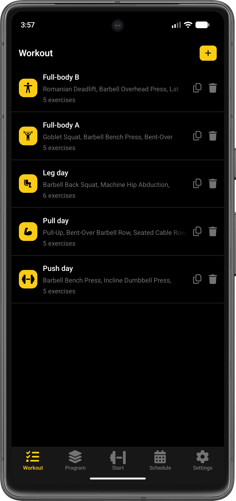
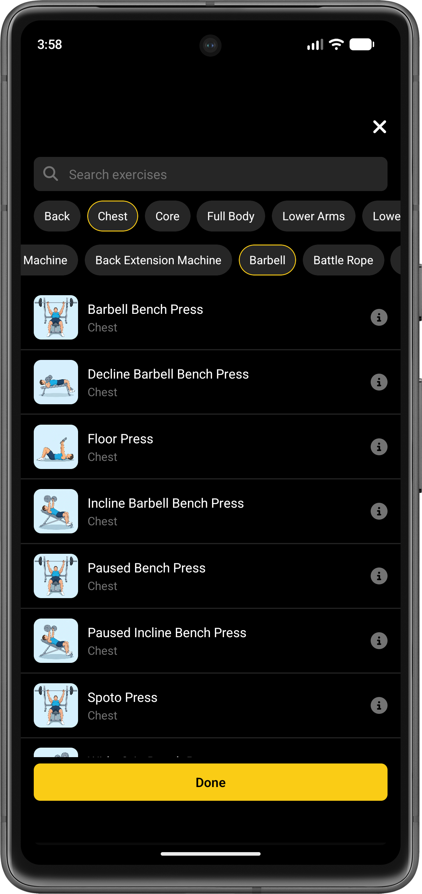
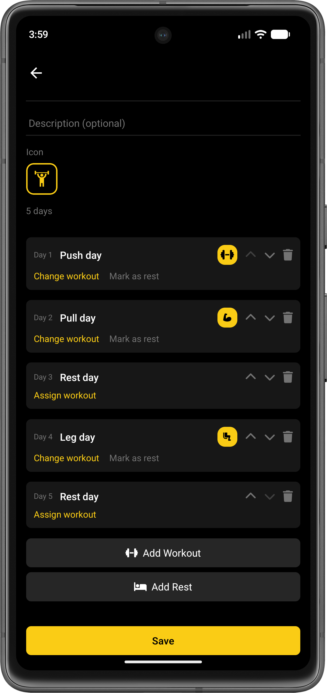
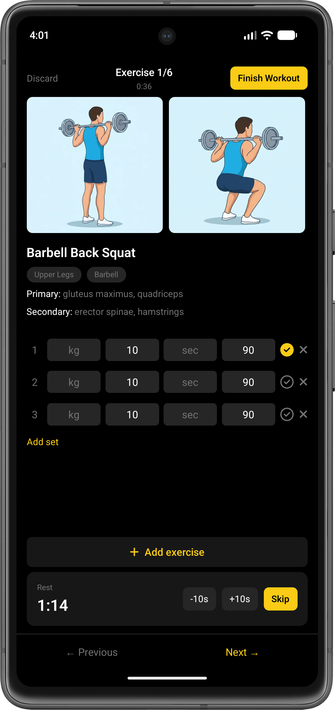
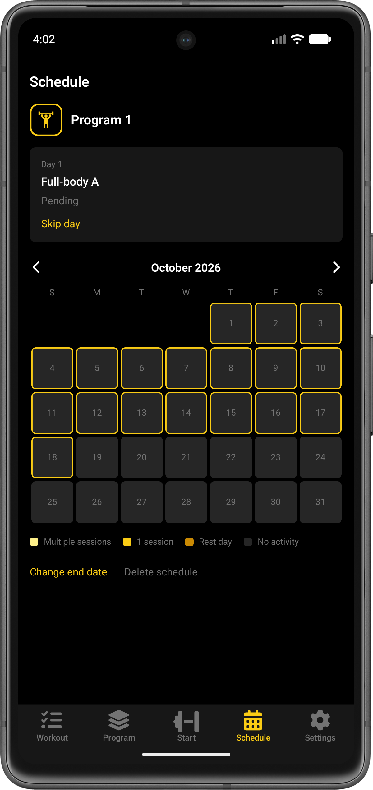
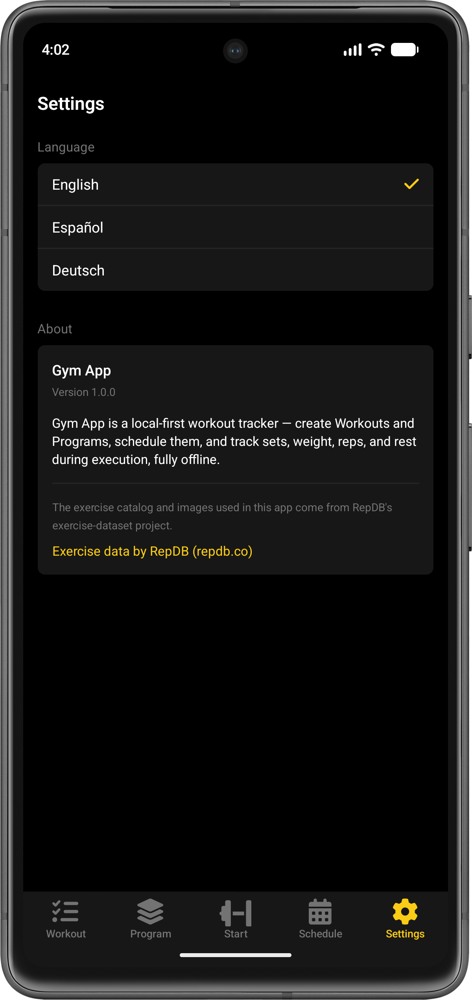

# Gym App

A mobile gym workout tracker built with **React Native + Expo**, following a **local-first / offline-first** architecture. There is no backend: SQLite on the device is the single source of truth, and every core feature works without a network connection.

You create **Workouts** (ordered exercises with sets), group them into **Programs** (a repeating cycle of workout and rest days), **schedule** a Program on a calendar, and then **execute** each workout with set tracking, load, reps/time, a session timer and a rest timer.

The app is available in **English, Spanish and German**.

## Screenshots

| Workout | Exercise catalog | Program |
|---|---|---|
|  |  |  |

| Workout execution | Schedule | Settings |
|---|---|---|
|  |  |  |

## Spec-driven development

This project is built **spec-first**. Every product and technical decision lives in [`spec/`](spec/), and the code is written to match it, not the other way around.

### How it works

1. **The spec is the source of truth.** Before implementing or changing behavior, read the spec file for that area. Each feature file describes exactly what that part of the app does, including the "why" behind non-obvious rules.
2. **Gaps are fixed in the spec first.** If a bug, gap or contradiction shows up while implementing, resolve it in the spec, then write the code to match.
3. **The spec never falls behind.** When a decision changes, the relevant spec file is updated in the same change. Each feature file also carries *implementation notes* per roadmap step, recording what was built and what was deliberately left out.
4. **Open questions stay visible.** Decisions deliberately left unresolved are marked with `> **Open question**` callouts. They are surfaced and decided explicitly, not silently resolved in code.
5. **Work follows a fixed build order.** [`implementation-roadmap.md`](spec/process/implementation-roadmap.md) defines 19 incremental steps (setup, NativeWind, navigation, SQLite, dataset import, i18n, catalog, CRUD, scheduling engine, execution, timers, recovery, history, settings, tests, offline verification). Each step keeps the app runnable.
6. **"Done" is defined up front** in [`acceptance-criteria.md`](spec/process/acceptance-criteria.md).

### Spec layout

| Folder | Contents |
|---|---|
| [`spec/product/`](spec/product/) | What the app is and how it should feel: [overview](spec/product/overview.md), [UX guidelines](spec/product/ux-guidelines.md) |
| [`spec/technical/`](spec/technical/) | Cross-cutting decisions: [stack](spec/technical/stack.md), [architecture](spec/technical/architecture.md), [data model](spec/technical/data-model.md), [database schema](spec/technical/database-schema.md), [i18n](spec/technical/i18n.md), [dataset & licensing](spec/technical/dataset-and-licensing.md), [business rules](spec/technical/business-rules.md) |
| [`spec/features/`](spec/features/) | One file per screen: [workout](spec/features/workout.md), [program](spec/features/program.md), [schedule](spec/features/schedule.md), [start](spec/features/start.md), [workout execution](spec/features/workout-execution.md), [navigation](spec/features/navigation.md), [settings](spec/features/settings.md) |
| [`spec/process/`](spec/process/) | [Acceptance criteria](spec/process/acceptance-criteria.md), [implementation roadmap](spec/process/implementation-roadmap.md), [delivery scope](spec/process/delivery-and-roadmap.md) |

Suggested reading order for a newcomer: product overview, then stack and architecture, then data model, then the feature file for whatever you are about to touch, and the database schema before any migration or query.

[`CLAUDE.md`](CLAUDE.md) and [`AGENTS.md`](AGENTS.md) hold the project guide for AI coding agents working in this repo, including a "I need to..." lookup table into the spec.

## Features

### Workout

<table>
<tr>
<td width="240" valign="top">


</td>
<td valign="top">

The **Workout** tab lists every Workout you have created: name, a preview of its exercises, the exercise count and a custom icon. From each row you can **duplicate** or **delete** a Workout, and the **+** button creates a new one. Deleting or editing a Workout that is part of an active schedule shows a warning first.

</td>
</tr>
</table>

### Exercise catalog

<table>
<tr>
<td width="240" valign="top">


</td>
<td valign="top">

When adding exercises to a Workout you pick from a bundled catalog of 600+ exercises, each with start/peak images. You can search by name and filter by **body part** (top row) and **equipment** (second row). The **i** button opens the exercise details (muscles, instructions), and **Done** returns to the Workout editor. The catalog ships inside the app, so it works fully offline.

</td>
</tr>
</table>

### Program

<table>
<tr>
<td width="240" valign="top">


</td>
<td valign="top">

A **Program** is an ordered cycle of days. Each day is either a Workout day or a **Rest** day. In the editor you can:

- set a description and an icon,
- **Change workout** or **Mark as rest** on any day, or **Assign workout** to a rest day,
- reorder days with the up/down arrows and delete days,
- use **Add Workout** / **Add Rest** to extend the cycle.

The example shown is a 5-day cycle: Push, Pull, Rest, Legs, Rest. Programs can also be duplicated.

</td>
</tr>
</table>

### Start

The **Start** tab is the entry point to a workout. If a schedule is active, today's day is shown first: the pending Workout (with a "Start workout" action), or a Rest indicator. If no Program is selected it offers **Choose Program**, which opens the same schedule form used on the Schedule screen. Below that, every Workout can be started directly, with or without a Program. Starting something other than what the schedule planned shows a warning, because it cancels the current schedule.

### Workout execution

<table>
<tr>
<td width="240" valign="top">


</td>
<td valign="top">

The live workout screen shows one exercise at a time ("Exercise 1/6"):

- **Session timer** under the title, and **Finish Workout** / **Discard** in the header.
- Start and peak pose images, the exercise name, body-part and equipment tags, and primary and secondary muscles.
- A **set table** with weight (kg), reps, time (sec) and rest columns. Tick a set to complete it, remove it with the **x**, or use **Add set**.
- **Add exercise** to add one to the session on the fly.
- A **rest timer** starts when a set is completed, with **-10s**, **+10s** and **Skip**.
- **Previous / Next** to move between exercises.

Timers are timestamp-based, so they stay correct when the app is backgrounded. Every change is written to SQLite immediately, so an interrupted session can be **resumed or discarded** the next time the app opens. Finished sessions are saved to history, including configured and actual rest.

</td>
</tr>
</table>

### Schedule

<table>
<tr>
<td width="240" valign="top">


</td>
<td valign="top">

The **Schedule** tab applies a Program to a calendar. You choose the Program, which cycle day to start on, the start date, and an end date (or no end for a continuous program). The screen shows:

- the **current day** card ("Day 1, Full-body A, Pending") with a **Skip day** action,
- a month calendar **heatmap**: yellow outline for planned days, and fills for multiple sessions, one session, rest days and no activity,
- **Change end date** and **Delete schedule**.

If you miss a workout day, the cycle **slides automatically**: the pending day stays pending until you complete it, rather than silently moving on. Only one schedule can be active at a time. This is the most complex part of the app, and its logic lives in pure, unit-tested functions in `src/domain/schedule/`. See [`spec/features/schedule.md`](spec/features/schedule.md).

</td>
</tr>
</table>

### Settings

<table>
<tr>
<td width="240" valign="top">


</td>
<td valign="top">

Choose the language (**English**, **Español**, **Deutsch**) and read the **About** section, which includes the required attribution to [RepDB](https://repdb.co) for the exercise dataset.

</td>
</tr>
</table>

## Tech stack

- React Native, Expo (SDK 54), TypeScript
- Expo Router for file-based navigation
- `expo-sqlite` with versioned migrations for local persistence
- NativeWind (Tailwind) for styling: black background, dark gray surfaces, yellow primary
- `i18next` / `react-i18next` for EN, ES, DE
- `@react-native-vector-icons` for icons
- Jest with `jest-expo` for unit tests

Architecture in short: UI screens in `src/features/*` call repositories in `src/data/sqlite/`, while pure business logic (such as the schedule cycle engine) lives in `src/domain/`. See [`spec/technical/architecture.md`](spec/technical/architecture.md).

## Running the app on your computer

### Prerequisites

- [Node.js](https://nodejs.org/) (LTS) and npm
- For a physical phone: the **Expo Go** app (iOS / Android), on the same Wi-Fi network as your computer
- For an emulator: Android Studio (Android emulator) or Xcode (iOS simulator, macOS only)

### Steps

```bash
# 1. Clone and enter the project
git clone <repository-url>
cd gym-app

# 2. Install dependencies
npm install

# 3. Start the Expo dev server
npm start
```

Then, from the terminal that `npm start` opened:

- press **a** to open on an Android emulator,
- press **i** to open on an iOS simulator (macOS only),
- press **w** to open in the browser,
- or scan the QR code with **Expo Go** on your phone.

You can also launch a target directly:

```bash
npm run android
npm run ios
npm run web
```

There is no backend, API key or environment variable to configure. The database is created and migrated on the device at first launch.

> This project uses a recent Expo SDK. Check the versioned docs at <https://docs.expo.dev/versions/v57.0.0/> if something behaves differently from what you expect.

### Running the tests

```bash
npm test            # run once
npm run test:watch  # watch mode
```

## Project structure

```
spec/            Product, technical, feature and process specs (source of truth)
src/
  app/           Expo Router routes (tabs, program, session, workout)
  components/    Shared UI components
  features/      Per-feature screens, hooks and logic
  domain/        Pure business logic (schedule cycle engine)
  data/sqlite/   Migrations and repositories
  i18n/          Translations (EN, ES, DE)
  lib/           Shared helpers (dates, timers)
assets/          Fonts, images and the vendored exercise dataset
scripts/         Dataset helper scripts
docs/            README screenshots
```

## Exercise dataset and attribution

The exercise catalog and images come from [RepDB](https://repdb.co)'s exercise-dataset project, used under the **RepDB Free Tier License**. Only free-tier flat images are bundled, and attribution is shown in the app under **Settings > About**. Details: [`spec/technical/dataset-and-licensing.md`](spec/technical/dataset-and-licensing.md).
